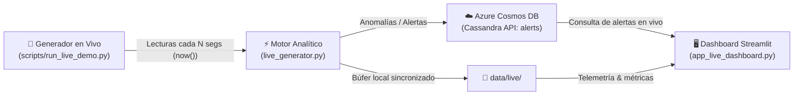

# 🚀 Guía de Demostración en Tiempo Real (Azure Cosmos DB Cassandra + Streamlit)

Este documento detalla los pasos para realizar la presentación oral en vivo del **Sistema Big Data de Mantenimiento Predictivo**, demostrando la ingesta continua de sensores, la detección en tiempo real de anomalías y la persistencia de alertas en la nube con **Azure Cosmos DB (Cassandra API)**.

---

## 🏗️ 1. Arquitectura de la Demostración



### Componentes:
1. **Generador y Pipeline en Vivo (`scripts/run_live_demo.py`)**:
   - Emite telemetría continua para $N$ máquinas con timestamps UTC reales (`now()`).
   - Inyecta anomalías físicas: picos térmicos, vibración anormal, fallas de presión y degradación sostenida.
   - Aplica los umbrales de riesgo oficiales (`RiskThresholds`):
     - **Temperatura**: Amarillo $\ge 89.5^\circ\text{C}$ | Rojo $\ge 94.0^\circ\text{C}$
     - **Vibración**: Amarillo $\ge 6.0\text{ mm/s}$ | Rojo $\ge 6.8\text{ mm/s}$
     - **Presión**: Amarillo $\ge 8.0\text{ bar}$ | Rojo $\ge 8.6\text{ bar}$
   - Escribe inmediatamente las alertas en **Azure Cosmos DB (Cassandra API)**.
2. **Base de Datos NoSQL Distribuida (Azure Cosmos DB Cassandra API)**:
   - Endpoint: `basededatos3.cassandra.cosmos.azure.com:10350` con TLS/SSL.
   - Keyspace: `bd3_mantenimiento`
   - Tabla: `alerts` particionada por `machine_id` y ordenada por `timestamp DESC`.
3. **Frontend Interactivo en Vivo (`app_live_dashboard.py`)**:
   - Desarrollado con **Streamlit**.
   - Tarjetas de estado con semáforo industrial (Verde / Amarillo / Rojo).
   - Gráficos de tendencias en vivo de sensores por máquina.
   - Registro de incidentes consumido en tiempo real directo desde Azure Cosmos DB.

---

## 🎬 2. Pasos para Ejecutar la Demostración el Día de la Defensa

### Paso 1: Abrir dos terminales en la raíz del proyecto

#### **Terminal 1: Iniciar el Generador y Pipeline en Streaming**
```powershell
.venv\Scripts\python scripts/run_live_demo.py --interval 2.0 --machines 5 --anomaly-rate 0.20
```

*Verás en pantalla los logs en vivo:*
```text
============================================================================
   SISTEMA BIG DATA: GENERADOR Y PIPELINE EN TIEMPO REAL (FASE 3)
============================================================================
  * Intervalo entre emisiones: 2.0 segundos
  * Máquinas monitoreadas:     5 (MAQ-001 .. MAQ-005)
  * Tasa de anomalías:         20.0%
  * Nube de alertas:           Azure Cosmos DB (Cassandra API)
  * Host / Keyspace:           basededatos3.cassandra.cosmos.azure.com | bd3_mantenimiento.alerts
============================================================================

[06:07:14 UTC] [🚨 ALERTA ROJA] MAQ-002: Temperatura: 98.4 °C; ROJO (>= 94.0 °C) -> [☁️ AZURE CASSANDRA PERSISTIDA]
[06:07:14 UTC] [📡 TELEMETRÍA #001] 5 lecturas: MAQ-001:66.69°C/2.09mm/s | MAQ-002:98.4°C/2.5mm/s ...
```

---

#### **Terminal 2: Iniciar el Dashboard Visual de Monitoreo**
```powershell
.venv\Scripts\streamlit run app_live_dashboard.py
```

*Se abrirá automáticamente el navegador en `http://localhost:8501` mostrando:*
- **Indicador de Conexión**: ☁️ *Azure Cosmos DB: Conectado*.
- **Tarjetas de Máquinas**: Semáforo visual con cambios de estado y lecturas instantáneas.
- **Gráficos en Vivo**: Curvas de evolución de temperatura, vibración y presión con líneas de umbral.
- **Tabla de Alertas Cloud**: Filas que aparecen en tiempo real directamente desde Azure.

---

## 🔍 3. Cómo demostrar la persistencia en Azure a los profesores

1. **Desde el Dashboard**:
   - En la sección inferior *"Registro de Alertas en Azure Cosmos DB"*, mostrar cómo cada vez que la consola detecta una alerta roja o amarilla, la fila se inserta en Azure y aparece en la tabla del panel.
2. **Desde la Consola / Python en vivo**:
   Podés abrir una terminal rápida y correr:
   ```powershell
   .venv\Scripts\python -c "from src.storage.load_results import get_cassandra_session; cl, s = get_cassandra_session(); [print(r.machine_id, r.timestamp, r.level, r.description) for r in s.execute('SELECT * FROM alerts LIMIT 10')]; cl.shutdown()"
   ```
3. **Desde Azure Portal**:
   - Ir al recurso `basededatos3` en Azure Portal.
   - Entrar al **Explorador de Datos (Data Explorer)**.
   - Abrir el Keyspace `bd3_mantenimiento` -> Tabla `alerts`.
   - Ejecutar la query CQL:
     ```sql
     SELECT * FROM alerts;
     ```

---

## 🛑 4. Detener la demostración
- En la Terminal 1 (generador): presionar `Ctrl+C`. El script imprimirá el resumen final de lecturas y cerrará la conexión con Azure.
- En la Terminal 2 (dashboard): presionar `Ctrl+C`.
